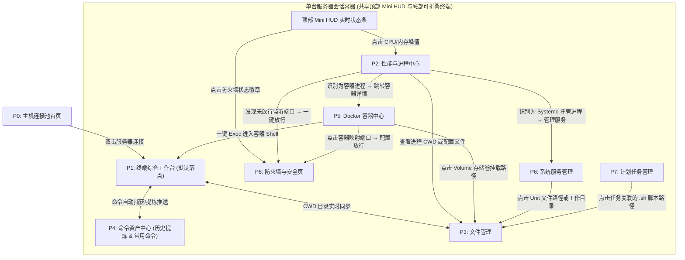

# TermForYou 服务器管理面板 — 产品需求文档 (PRD) 与 UI/UX 架构设计

> [!IMPORTANT]
> **产品核心理念**：「以终端为中心的可视化运维工作台 (Terminal-Centric Visual Ops Workbench)」。不仅解决传统 Web 面板（如 1Panel、宝塔）操作路径长、终端体验割裂的问题，也弥补传统 SSH 客户端（如 Termius、FinalShell）在系统服务、防火墙、计划任务和容器编排上缺乏深度可视化管理的短板。

---

## 一、 产品定位与目标用户

### 1.1 产品形态选型（支持双模式演进）
- **形态 A：桌面端免 Agent 模式（推荐起步，基于 Electron / Tauri / Wails）**
  - 通过标准 `SSH + SFTP` 协议直连目标 Linux 服务器，零远端依赖（无需在服务器安装后台守护进程），通过底层命令解析器（Command Parser）将 `systemctl`、`crontab`、`docker`、`ufw/iptables`、`ps/proc` 转化为 GUI。
- **形态 B：Web 自托管 / 轻量 Agent 模式**
  - 部署单二进制服务端，通过 WebSocket 提供极速实时监控流、历史性能回溯与告警通知。

### 1.2 核心差异化亮点
1. **GUI 与 CLI 双向透明映射**：任何可视化操作（如新建防火墙规则、修改 systemd 配置、创建 Docker 容器）均可实时预览生成的底层 Shell 命令，并一键转存为「常用命令」。
2. **智能历史命令提炼引擎**：自动清洗 `.bash_history` / `.zsh_history` 与面板内执行记录，聚类高频命令流、提取动态参数变量，一键转化为可复用的参数化命令模板。
3. **跨模块上下文联动**：从「端口占用」一键跳至「对应进程/容器」或「防火墙放行」；从「计划任务脚本路径」一键在「文件管理器」打开并编辑。

---

## 二、 十大核心功能模块详细需求

### 2.1 终端命令行 (Terminal CLI)
| 功能点 | 详细需求说明 | 优先级 |
| :--- | :--- | :--- |
| **多标签与分屏** | 支持多服务器 Tab 页切换、同窗口水平/垂直分屏（Split Pane）、广播输入（同时向多个终端发送相同指令）。 | P0 |
| **命令内联补全与提示** | 基于「历史命令库」与「常用命令库」提供 Ghost Text 幽灵文本自动补全；输入高危命令（如 `rm -rf`、`mkfs`、`iptables -F`）时弹出二次确认拦截。 | P0 |
| **工作目录同步 (Follow CWD)** | 终端内执行 `cd` 切换目录时，底部或侧边的「文件管理面板」自动同步跳转到当前路径（基于 OSC 7 转义序列或 `pwd` 探测）。 | P1 |
| **输出块捕获与检索** | 支持按命令执行边界折叠输出、一键复制单次命令的标准输出、正则高亮报错关键字（`ERROR`、`WARN`、`Failed`）。 | P1 |

### 2.2 历史命令统计与自动提炼 (Command History Analytics & Auto-Extraction)
> [!TIP]
> 这是产品的核心生产力引擎，帮助用户把散落在历史记录里的「隐性经验」自动转化为「结构化资产」。

| 功能点 | 详细需求说明 | 优先级 |
| :--- | :--- | :--- |
| **多源采集与去噪** | 自动读取远端 `$HISTFILE`（`.bash_history` / `.zsh_history`）及面板内终端会话记录；自动过滤无效命令（拼写错误返回非 0 退出码、纯 `ls`/`cd`/`clear` 等低价值噪音）。 | P0 |
| **多维统计看板** | 统计高频命令 Top 20、命令前缀分布（`git`、`docker`、`systemctl`、`kubectl` 等）、时段活跃度热力图、高耗时/高失败率命令排行。 | P1 |
| **智能参数化提炼 (Auto-Templating)** | 自动识别相似命令并聚类提取变量占位符。例如识别到历史中多次执行：<br>`docker logs -f --tail 100 nginx-prod`<br>`docker logs -f --tail 200 redis-cache`<br>系统自动提炼候选模板：`docker logs -f --tail {{lines=100}} {{container_name}}`，提示用户「一键加入常用命令」。 | P0 |
| **工作流序列发现 (Sequence Mining)** | 识别连续执行的命令组合（如 `git pull` → `npm run build` → `systemctl restart app`），推荐打包为「组合宏命令 / 一键脚本」。 | P2 |

### 2.3 常用命令管理 (Snippets & Command Library)
| 功能点 | 详细需求说明 | 优先级 |
| :--- | :--- | :--- |
| **分类与作用域** | 支持按文件夹/标签管理（如「网络排查」、「Docker 运维」、「日志分析」）；支持设置作用域（全局通用 / 仅特定服务器组生效）。 | P0 |
| **参数化表单弹窗** | 命令支持 `{{变量名:默认值:描述}}` 语法。点击执行时，若包含变量则弹出轻量级参数填写卡片（支持下拉枚举，如动态拉取当前容器列表供选择），填写后注入当前激活终端。 | P0 |
| **执行模式选择** | 支持「直接发送并回车」、「仅粘贴到终端输入框（不回车）」、「后台静默执行并弹窗展示结果」三种执行方式。 | P0 |

### 2.4 文件管理 (File Manager)
| 功能点 | 详细需求说明 | 优先级 |
| :--- | :--- | :--- |
| **双栏/树状浏览与书签** | 支持路径面包屑快速跳转、收藏常用目录（如 `/etc/nginx`、`/var/log`）、隐藏文件开关、按大小/修改时间排序。 | P0 |
| **内置代码编辑器** | 集成 Monaco Editor，支持语法高亮、代码折叠、编码切换、行尾符（LF/CRLF）转换；保存时若权限不足，支持提示使用 `sudo tee` 提权写入。 | P0 |
| **传输队列与压缩解压** | 支持拖拽上传、断点续传、后台传输进度条抽屉；支持右键直接打包（`.tar.gz` / `.zip`）与一键解压到当前目录。 | P0 |
| **权限与属性可视化** | 图形化修改 `chmod`（九宫格勾选读写执行 + 实时显示 `0755` 八进制值与 `-rwxr-xr-x`）及 `chown` 用户/用户组变更，支持递归应用。 | P1 |
| **目录大小分析** | 一键扫描当前目录各子文件夹磁盘占用比例（类似 `ncdu` 可视化条形图），快速定位大文件。 | P2 |

### 2.5 性能监控 (Performance Monitoring)
| 功能点 | 详细需求说明 | 优先级 |
| :--- | :--- | :--- |
| **核心指标实时仪表盘** | CPU 使用率（总览 + 单核矩阵 + Load Average 1/5/15min）、内存与 Swap 占用（区分 Used / Buffers / Cached）、磁盘容量与挂载点、实时磁盘读写 IOPS/吞吐量、网卡实时上下行速率。 | P0 |
| **ミニ状态栏常驻 (Mini HUD)** | 在终端与各子页面顶部/底部常驻极简微缩指标条（CPU / RAM / Net ↑↓），点击任意指标可直接展开详细监控抽屉。 | P0 |
| **资源异动归因** | 当 CPU 或内存突增时，折线图时间轴支持点击查看当时占用 Top 5 的进程快照。 | P1 |

### 2.6 进程监控 (Process Monitor)
| 功能点 | 详细需求说明 | 优先级 |
| :--- | :--- | :--- |
| **交互式进程表** | 展示 PID、进程名、完整启动命令 (Cmdline)、所属用户、状态 (R/S/D/Z)、CPU%、MEM%、运行时间；支持关键字/PID/端口实时过滤与列排序。 | P0 |
| **端口反查进程** | 内置「监听端口视图」（解析 `ss -tulnp`），输入端口号（如 `8080`）立刻定位对应的 PID 与进程详情。 | P0 |
| **信号发送与进程树** | 支持切换父子进程树状视图；支持向进程发送 `SIGTERM (15)` 优雅停止、`SIGKILL (9)` 强制杀死、`SIGHUP (1)` 重载配置。 | P0 |
| **进程深度透视抽屉** | 点击任意进程展开详情：查看该进程当前打开的文件句柄 (Open Files)、监听的网络连接、环境变量 (`/proc/[pid]/environ`)、工作目录 (CWD，可一键跳转文件管理器)。 | P1 |

### 2.7 计划任务可视化管理 (Cron & Scheduled Tasks)
| 功能点 | 详细需求说明 | 优先级 |
| :--- | :--- | :--- |
| **双引擎统一纳管** | 同时支持传统 `Crontab`（系统级 `/etc/crontab`、`/etc/cron.d/` 与用户级 `crontab -l`）以及现代 `Systemd Timers` 的统一列表展示。 | P0 |
| **Cron 表达式可视化构建器** | 提供「每 N 分钟 / 每天几点 / 每周几 / 自定义高级表达式」可视化选择器，并**实时用自然语言翻译显示未来 5 次执行的具体时间点**（防止写错表达式）。 | P0 |
| **一键立即试运行与日志闭环** | 支持选中某条计划任务点击「立即执行一次（测试）」，实时弹窗展示标准输出与标准错误；支持自动为任务追加日志重定向（如 `>> /var/log/cron_xxx.log 2>&1`）并在面板内一键查看执行日志。 | P0 |
| **启停与安全备份** | 支持单条任务一键启用/禁用（底层通过注释 `#` 实现，无需删除）；每次修改自动在本地保存历史版本以便回滚。 | P1 |

### 2.8 系统服务可视化管理 (Systemd Services)
| 功能点 | 详细需求说明 | 优先级 |
| :--- | :--- | :--- |
| **服务全景列表与分类筛选** | 按状态筛选：`Running（运行中）`、`Failed（异常退出）`、`Enabled（开机自启）`、`Disabled`；区分系统核心服务与用户自定义服务。 | P0 |
| **生命周期一键控制** | 启动 (Start)、停止 (Stop)、重启 (Restart)、重载配置 (Reload)、开启/关闭开机自启 (Enable/Disable)。 | P0 |
| **Unit 文件可视化向导与编辑** | 提供「新建自定义服务向导」：只需填写服务名、工作目录、启动命令、运行用户、崩溃重启策略 (`Restart=always`)，即可自动生成标准 `.service` 文件并执行 `daemon-reload`。同时支持源码模式直接编辑 Unit 文件。 | P0 |
| **Journalctl 实时日志流** | 点击任意服务即可在右侧抽屉实时流式查看 `journalctl -u <service> -f` 日志，支持按时间范围、日志级别（Error/Warning）过滤。 | P0 |

### 2.9 Docker 可视化管理 (Docker Management)
| 功能点 | 详细需求说明 | 优先级 |
| :--- | :--- | :--- |
| **容器全生命周期管理** | 容器列表展示状态、CPU/内存实时占用、端口映射（可点击直达或跳转防火墙）；支持启动/停止/重启/删除、**一键进入容器终端 (`docker exec -it`)**、实时流式日志查看。 | P0 |
| **Docker Compose 编排管理** | 扫描并纳管服务器上的 `docker-compose.yml` 项目栈，支持可视化编辑 YAML、一键 `up -d` / `down` / `pull` 更新镜像并重启。 | P0 |
| **镜像、网络与存储卷** | 镜像列表（支持拉取新镜像、清理悬空 `<none>` 镜像）；数据卷 Volume 列表（支持**一键在文件管理器中打开宿主机挂载目录 `/var/lib/docker/volumes/...`**）；网络拓扑查看。 | P1 |
| **一行 `docker run` 与表单互转** | 支持粘贴一条复杂的 `docker run ...` 命令自动解析为可视化创建表单（或转换为 `docker-compose.yml`），反之亦然。 | P1 |

### 2.10 防火墙可视化管理 (Firewall Management)
| 功能点 | 详细需求说明 | 优先级 |
| :--- | :--- | :--- |
| **多后端自适应适配** | 自动探测服务器使用的防火墙后端（`UFW` / `Firewalld` / 原生 `iptables` / `nftables`），向上提供统一的规则视图。 | P0 |
| **规则卡片与端口矩阵** | 直观展示入站 (Inbound) / 出站 (Outbound) 规则：端口/端口段、协议 (TCP/UDP/All)、来源 IP/CIDR（全部放行或白名单指定 IP）、动作 (Allow/Deny/Reject)、备注说明。 | P0 |
| **服务监听与防火墙状态联动对比** | **核心痛点解决**：自动对比当前服务器实际监听的端口（来自进程/Docker）与防火墙放行规则，直观标记：`[已监听 & 已放行]`、`[已监听但被防火墙拦截]`、`[防火墙已放行但无服务监听]`。 | P0 |
| **防呆防锁死保护 (Anti-Lockout)** | 当用户启用防火墙或修改规则未包含当前 SSH 连接端口（如 `22` 端口）时，强制拦截并弹出警告，支持「自动放行当前 SSH 端口」及「规则测试模式（30 秒内未确认连接正常则自动回滚规则）」。 | P0 |

---

## 三、 UI 架构设计：窗口、页面与布局体系

为了兼顾「高频敲命令」与「低频做配置」的不同场景，UI 采用 **「单主窗口 + 双模工作区 + 上下文滑出抽屉 (Slide-over Drawer) + 全局命令面板 (`Cmd/Ctrl + K`)」** 的现代架构，避免弹窗套弹窗。

### 3.1 窗口体系 (Window Hierarchy)
1. **主工作台窗口 (Main Workbench Window)**：承载 95% 的核心操作，支持多服务器会话标签页 (Server Session Tabs)。
2. **独立浮动窗口 (Detached Floating Windows)**（可按需从主窗口拖出）：
   - **独立代码/配置编辑器窗口**：比对修改多份配置文件时可独立置顶。
   - **独立实时日志监控窗 (Log Tailer Window)**：盯盘查看某个服务或容器的 `tail -f` 日志。
3. **全局模态窗 (Modals)**（仅用于强阻断或向导）：
   - 新建/编辑服务器连接弹窗 (SSH Host Modal)
   - 全局命令面板 (`Cmd/Ctrl + K` Spotlight)
   - 参数化命令变量填写弹窗
   - 高危操作/命令执行二次确认弹窗

### 3.2 主窗口布局结构 (Main Window Layout)

```
+---------------------------------------------------------------------------------------------------+
| [Logo] [主机连接池] | [Tab 1: Prod-Web-01 (混合工作台)] [Tab 2: DB-Master] [+]     [Cmd+K] [设置] | <- 1. 顶栏 (Top Bar)
+----------+----------------------------------------------------------------------------------------+
| 导航栏   | [CPU: 24%] [MEM: 4.2/8G] [Disk: 61%] [Net: ↑1.2M ↓450K] [防火墙: 开启]  [终端抽屉开关] | <- 2. 迷你监控栏 (Mini HUD)
| (Sidebar)|----------------------------------------------------------------------------------------|
|          |                                                                                        |
| [⚡工作台]|                                                                                        |
| [📊监控] |                          主 视 图 工 作 区 (Main Stage)                                |
| [⚙️进程] |             (根据左侧导航切换页面；在「⚡工作台」模式下为 终端 + 文件 + 命令库 组合分屏)     |
| [📁文件] |                                                                                        |
| [🐳容器] |                                                                                        |
| [🧩服务] |----------------------------------------------------------------------------------------|
| [⏱️任务] |  [底栏折叠区 / 上下文终端 & 传输队列 & 实时日志流 (Bottom Dock - 可随时呼出/收起)]        |
| [🛡️防火墙]|  root@prod-web-01:/etc/nginx# _                                                        |
| [🧠命令库]|                                                                                        |
+----------+----------------------------------------------------------------------------------------+
```

### 3.3 页面清单 (Pages Inventory)

每个已连接的服务器会话 Tab 内包含 **1 个综合工作台视图 + 8 个专职可视化子页面**：

| 页面编号 | 页面名称 | 核心布局设计 | 核心组件 |
| :--- | :--- | :--- | :--- |
| **P0** | **主机连接池首页 (Hosts Hub)** | 网格卡片 / 分组树 | 服务器卡片（展示上次连接状态、标签、分组）、快速 SSH 连接栏、SSH 密钥管理器。 |
| **P1** | **终端综合工作台 (Terminal Workbench)** | 三栏可拖拽分屏 | **上左**：多分屏终端 (CLI)；**上右**：常用命令 & 历史提炼侧边栏；**下栏**：跟随终端路径的紧凑型文件管理器。 |
| **P2** | **性能与进程中心 (Metrics & Processes)** | 上下分栏 / 子标签 | **上半区**：CPU/内存/IO/网络实时趋势图表；**下半区**：交互式进程表 + 端口监听反查表。 |
| **P3** | **文件管理全屏页 (Full File Explorer)** | 左右双栏 + 底部传输 | 左侧目录树与收藏书签，右侧文件详情列表/磁盘占用分析，右侧滑出内置代码编辑器。 |
| **P4** | **命令资产中心 (Command Intelligence)** | 左右分栏 + 统计顶栏 | **Tab A 常用命令库**：分类树 + 参数化命令卡片；**Tab B 历史命令统计与自动提炼**：高频统计图 + 待确认的自动提炼模板池。 |
| **P5** | **Docker 容器中心 (Docker Studio)** | 顶部概览 + 4 个子 Tab | 子 Tab：`容器列表`、`Compose 编排栈`、`镜像管理`、`网络与存储卷`；内置 `docker run` 可视化向导。 |
| **P6** | **系统服务管理页 (Systemd Manager)** | 列表 + 右侧详情工作区 | 左侧服务列表（支持按 Running/Failed 过滤），右侧展示当前选中服务的运行状态、Unit 配置文件编辑器与 `journalctl` 实时日志。 |
| **P7** | **计划任务管理页 (Cron & Timers)** | 列表 + 可视化构建抽屉 | 任务列表（展示下次执行倒计时、上次执行状态）+ 右侧 Cron 可视化生成器与测试执行输出面板。 |
| **P8** | **防火墙与安全页 (Firewall & Ports)** | 端口矩阵 + 规则列表 | 顶部「实际监听端口 vs 防火墙放行状态」全景对照条，下方入站/出站规则表与快捷放行弹窗。 |

---

## 四、 页面跳转与跨模块深度联动设计 (Navigation & Cross-Module Flows)

> [!NOTE]
> 优秀的服务器面板绝不能让各个功能沦为信息孤岛。以下定义了 **全局导航机制** 与 **10 条高频跨模块一键跳转链路**。

### 4.1 架构跳转与联动全景图



### 4.2 四大核心跳转交互机制

#### 1. 全局底部/侧边「随行终端抽屉」(Persistent Terminal Dock)
- **交互逻辑**：当用户在切换左侧导航（如从 `P1 终端工作台` 切换到 `P6 系统服务` 或 `P8 防火墙`）时，**当前正在运行的 SSH 终端会话绝不中断或销毁**，而是自动收起到窗口底部的「随行终端抽屉」（快捷键 `` Ctrl + ` `` 一键展开/收起）。
- **价值**：用户在可视化页面看到任何异常（如某个服务启动失败），按一下 `` Ctrl + ` `` 即可在当前上下文立即呼出终端排查。

#### 2. 跨模块上下文直达链接 (Deep-Link Action Pills)
在各个可视化表格中，凡是涉及到 **路径 (Path)**、**端口 (Port)**、**进程 (PID)**、**命令 (Command)** 的字段，均渲染为可交互的胶囊按钮 (Action Pill)：

| 触发位置（源页面） | 点击元素 / 动作 | 目标页面与跳转效果 |
| :--- | :--- | :--- |
| **P1 终端工作台** | 终端内弹出提示：「检测到你连续执行了 3 次相似的 `find` 命令，是否提炼？」 | 打开 **P4 命令资产中心 - 提炼确认抽屉**，自动预填参数化模板 `{{dir}}` 与 `{{pattern}}`。 |
| **P4 命令资产中心** | 在「常用命令」点击某条带参数命令的 `[▶ 执行]` | 弹出 **参数输入小卡片** → 确认后自动激活 **底部随行终端**（或跳回 **P1**）并注入命令执行。 |
| **P2 进程监控** | 点击某个监听端口（如 `:8080` 旁边的 `[🛡️未放行]` 徽章） | 跳转到 **P8 防火墙页** 并自动打开「新增放行规则抽屉」，端口号自动填入 `8080`。 |
| **P2 进程监控** | 右键某进程 → `[打开进程所在目录]` | 跳转到 **P3 文件管理**，自动定位到 `/proc/[pid]/cwd` 指向的真实物理目录。 |
| **P5 Docker 容器** | 点击容器详情中的 `Volumes` 宿主机路径或 `Compose` 配置文件路径 | 跳转到 **P3 文件管理**，直接定位该目录或打开内置编辑器加载 `docker-compose.yml`。 |
| **P6 系统服务** | 点击服务详情中的 `Unit File: /etc/systemd/system/myapp.service` | 在当前页面右侧直接滑出 **内置代码编辑器抽屉** 编辑该文件，保存后底部出现 `[重载 daemon 并重启服务]` 按钮。 |
| **P7 计划任务** | 点击 Cron 任务命令中的脚本路径（如 `/opt/scripts/backup.sh`） | 右侧直接滑出 **文件编辑器抽屉** 修改脚本内容，并可一键点击 `[赋予 +x 执行权限]`。 |
| **P8 防火墙管理** | 在「监听端口对照表」中点击 `0.0.0.0:6379 (redis-server)` | 跳转到 **P2 进程监控** 并自动高亮过滤出该 `redis-server` 进程（若为容器端口则跳至 **P5 Docker**）。 |

#### 3. 「GUI 操作预览 CLI」透明机制 (Show Underlying Command)
- 在 **P5 Docker**、**P6 系统服务**、**P7 计划任务**、**P8 防火墙** 的所有新建/编辑弹窗底部，均设有 **`[>_ 预览底层命令]`** 折叠栏。
- 例如用户在防火墙页面通过表单添加了「允许 IP `192.168.1.0/24` 访问 TCP `3306` 端口」，底部实时显示：
  ```bash
  sudo ufw allow from 192.168.1.0/24 to any port 3306 proto tcp comment 'MySQL Internal'
  ```
- 旁边提供两个按钮：`[立即应用]` 与 **`[⭐ 存为常用命令]`**（点击后直接将该命令送入 **P4 常用命令库**）。

#### 4. 全局 Spotlight 命令面板 (`Cmd/Ctrl + K`)
在任何页面按下 `Cmd/Ctrl + K` 呼出全局搜索与动作框，支持：
- 输入 `> fw 80`：直接快速放行 80 端口
- 输入 `> restart nginx`：直接调用 Systemd 重启 nginx 服务
- 输入 `/etc/nginx/nginx.conf`：直接用内置编辑器打开远端文件
- 输入常用命令关键字：直接检索并执行常用命令

---

## 五、 历史命令统计与自动提炼算法设计（核心亮点落地）

为了让「历史命令自动提炼」真正可用且惊艳，建议采用以下三步流水线（无需重量级大模型即可在本地毫秒级完成，亦可可选接入 LLM 命名）：

1. **AST 级 Token 化与清洗 (Tokenization & Sanitization)**
   - 拉取 `$HISTFILE` 后，使用 Shell Lexer 拆解管道符 `|`、逻辑符 `&&` 和参数标志（Flags 如 `-f`, `--tail`）与位置参数（Positional Args）。
   - 过滤掉单单词命令（`ls`, `pwd`, `top`, `exit`）以及敏感凭证（自动掩码替换包含 `password=`、`TOKEN=` 的字符串）。
2. **结构指纹聚类 (Structural Fingerprinting)**
   - 将命令的主程序名 + 子命令 + Flag 集合作为「命令骨架指纹 (Skeleton Hash)」。
   - 例如 `docker logs --tail 100 web-1` 与 `docker logs --tail 50 db-2` 具有相同的骨架：`cmd=docker | sub=logs | flags=[--tail]`。
   - 当同一骨架在历史记录中出现次数 $\ge 3$，且仅位置参数或 Flag 值不同时，触发**参数化提炼规则**。
3. **动态变量槽位生成 (Variable Slot Inference)**
   - 对比同一聚类簇中的变化部分，根据值的特征自动推断变量类型：
     - 纯数字（如 `100`, `50`）→ 提炼为 `{{num:100}}`
     - 路径格式（包含 `/`）→ 提炼为 `{{path:/var/log}}`
     - IP 或端口格式 → 提炼为 `{{host_or_port}}`
     - 枚举字符串（如 `web-1`, `db-2`）→ 提炼为 `{{target}}` 并附带历史高频可选值下拉列表。

---

## 六、 后端架构与通信协议设计 (Backend Architecture & Communication Protocols)

> [!IMPORTANT]
> **无状态安全设计原则 (Zero Credential Storage & Native SSH Config First)**：
> 1. **前后端进程均不持久化存储任何服务器连接配置与私钥明文**。
> 2. **完全对齐 VS Code Remote - SSH 设计**：后端直接解析读取本地用户的 SSH 配置文件（`~/.ssh/config`，包含 `Host`、`HostName`、`Port`、`User`、`IdentityFile`、`ProxyJump` 等配置）。
> 3. **免密优先，交互降级**：
>    - 优先使用本机凭据连接（`ssh-agent` 转发、指定 `IdentityFile` 私钥免密登录）。
>    - 若需要口令或私钥密码（Passphrase），通过前端弹出一次性密码输入框（In-Memory），仅在当前内存会话握手时使用，握手完成立即在前后端垃圾回收，**绝不写入磁盘或数据库**。

### 6.1 后端技术栈：FastAPI + asyncssh (Python 3.11+)
- **HTTP / WebSocket 网关**：`FastAPI` + `Uvicorn`（异步高性能 ASGI 框架）。
- **异步 SSH / SFTP 核心库**：`asyncssh`（原生基于 `asyncio`，完美契合 FastAPI 事件循环，支持高并发持久通道、PTY 伪终端与 SFTP 流传输，免开启阻塞线程池；备选同步库为 `paramiko`）。
- **本地 SSH 配置解析器**：使用标准库或 `asyncssh.read_known_hosts` / `asyncssh.import_known_hosts` 解析 `~/.ssh/config`，动态转换为前端 P0 主机连接池列表。

### 6.2 前后端混合通信协议矩阵

| 场景 / 模块 | 传输协议 | 端点设计 (Endpoint) | 报文格式与说明 |
| :--- | :--- | :--- | :--- |
| **主机池发现 (P0)** | HTTP REST | `GET /api/v1/ssh/hosts` | 解析 `~/.ssh/config`，输出 Host 别名、IP、用户、端口、认证方式提示。 |
| **即时连接测试** | HTTP REST | `POST /api/v1/ssh/test-connect` | 探测目标端口连通性及是否需要提供密码/私钥口令。 |
| **交互式终端 (P1 / Bottom Dock)** | **WebSocket** | `WS /ws/terminal/{host_alias}` | **双向低延迟流**：传输终端输入按键、PTY ANSI 颜色回显、窗口 `resize {cols, rows}` 与中断信号。 |
| **秒级性能监控 (P2 Mini HUD)** | **WebSocket** | `WS /ws/metrics/{host_alias}` | 后端执行极轻量 `/proc` 采样脚本，按 1~2s 频率向下广播 CPU/内存/IO/网络 JSON 快照。 |
| **实时日志盯盘 (P5/P6 日志)** | WebSocket / SSE | `WS /ws/logs/{host_alias}?service=xxx` | 保持 `journalctl -f` 或 `docker logs -f` 流式增量推送。 |
| **文件管理 & 编辑器 (P3)** | HTTP REST + Multipart | `/api/v1/hosts/{alias}/files` | 目录树枚举、文件内容获取 (`GET`)、`sudo tee` 提权保存 (`PUT`)、大文件分块上传 (`POST`)。 |
| **进程/服务/Docker/防火墙 (P2, P5-P8)** | HTTP REST | `/api/v1/hosts/{alias}/{module}/*` | 标准 CRUD 与启停动作（如 `POST /systemd/restart`），返回统一结构化结果与错误码。 |

### 6.3 终端 WebSocket 通信协议规范 (`/ws/terminal/{host_alias}`)

前端与 Python 后端基于约定的 JSON 消息载荷进行通信：

```json
// 1. 前端 -> 后端：初始化连接参数（若需要手动提供临时密码）
{
  "action": "auth",
  "payload": {
    "password": "临时内存密码", // 可选，仅在缺少私钥且未配置免密时传入
    "passphrase": "私钥解密口令", // 可选
    "cols": 120,
    "rows": 36,
    "term": "xterm-256color"
  }
}

// 2. 前端 -> 后端：调整终端尺寸 (P1 终端拖拽分屏或随行抽屉缩放时发送)
{
  "action": "resize",
  "payload": { "cols": 140, "rows": 42 }
}

// 3. 前端 -> 后端：用户键盘按键输入或粘贴
{
  "action": "stdin",
  "payload": "systemctl status nginx\r"
}

// 4. 后端 -> 前端：PTY 终端输出回显 (ANSI 转义流)
{
  "action": "stdout",
  "payload": "\u001b[32m●\u001b[0m nginx.service - A high performance web server\r\n"
}

// 5. 双向心跳保活
{ "action": "ping" } <--> { "action": "pong" }
```

---

## 七、 建议的技术栈与分阶段研发路线图 (Roadmap)

### 7.1 技术栈总览
- **前端工作台**：Vue 3 + TypeScript + Tailwind CSS v4 + Vite + Lucide Icons（已完成 UI 9大页面与日夜间三态外观）。
- **终端与编辑器组件**：`xterm.js`（配合 Canvas/WebGL 与 Fit Addon） + `Monaco Editor`。
- **后端执行引擎**：**Python 3.11+ / FastAPI + asyncssh**。
- **凭据与存储机制**：**零数据库存储**，直接读取 `~/.ssh/config`，凭证完全依赖用户系统 SSH 秘钥环或运行时手动输入的会话临时密码。

### 7.2 MVP 三阶段迭代计划
- **Phase 1（核心基座与终端/文件直连）**：
  - Python FastAPI 搭建，提供 `~/.ssh/config` 解析接口；
  - 接入 `asyncssh` WebSocket 终端转发与 SFTP 文件读写；
  - 前端连接池加载真实本机 SSH 配置，实现真实终端登录与临时密码弹窗认证。
- **Phase 2（系统可观测性与服务管理）**：
  - 落地轻量 Python 远端监控脚本与 `/ws/metrics` 实时推送；
  - 完成 Systemd 服务管控与进程管理。
- **Phase 3（容器、网络与智能命令闭环）**：
  - Docker Socket 远端对接与防火墙规则探测；
  - 本地 AST 命令提炼引擎与全局 `Cmd+K` 联通。
